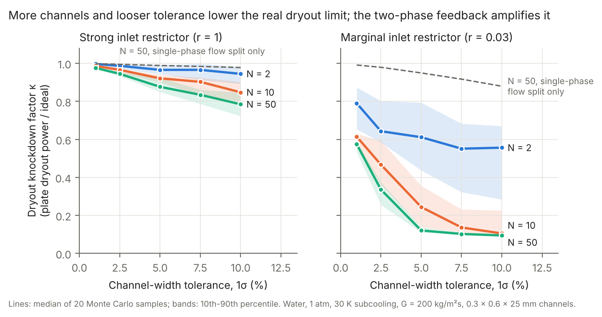
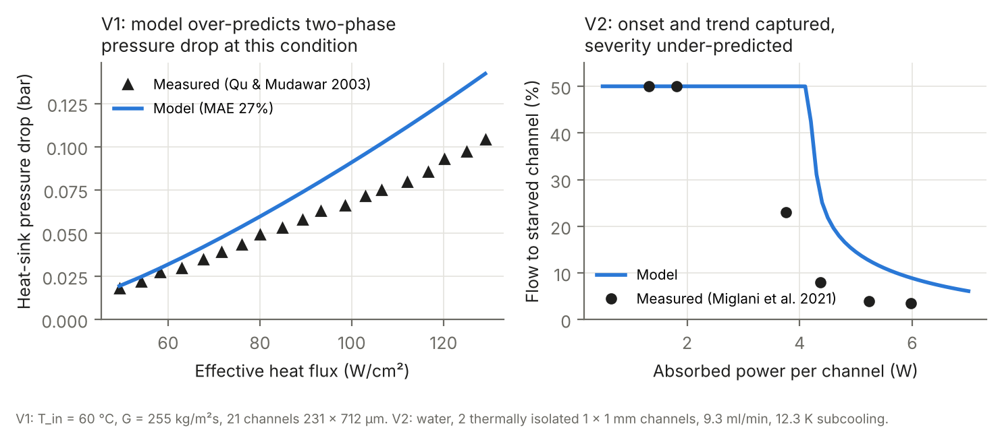

# Imperfection-Sensitive Dryout in Parallel-Channel Two-Phase Cold Plates

**A reduced-order model showing how small channel-to-channel manufacturing variations, amplified by the Ledinegg flow instability, lower the real dryout limit of two-phase cold plates.**

   

**Status:** a manuscript based on this code is in preparation. If you use the code before it is published, please cite the repository using [`CITATION.cff`](CITATION.cff).

## Key result

At a ±5 % channel-width tolerance, a 50-channel cold plate loses **about 12 % of its dryout power**, roughly **11× more** than a single-phase flow-split estimate predicts (about 1 %). With a marginal inlet restrictor, the loss can exceed 75 %.



| ±5 % width tolerance | Dryout power kept (κ) | Single-phase estimate |
|---|---|---|
| 2 channels, strong restrictor | 0.97 | 0.997 |
| 10 channels, strong restrictor | 0.92 | 0.993 |
| 50 channels, strong restrictor | 0.88 | 0.989 |
| 50 channels, marginal restrictor | 0.12 | 0.95 |

Median of 20 Monte Carlo samples per point; 600 runs in total.

## Why it matters

AI accelerators and power electronics are moving to two-phase cold plates. Design limits are usually computed for one ideal channel, but real plates have tens to hundreds of parallel channels with manufacturing tolerances. In boiling flow, a narrower channel gets less flow, boils more, gets even less flow (Ledinegg instability) and dries out first. This project asks how much that weakest-link effect lowers the plate-level dryout limit, by analogy with the knockdown factors used for imperfection-sensitive shell buckling.

## Model

- **Network:** N parallel heated microchannels between common plenums, fixed total flow; channel dynamics `I dm/dt = ΔP_plenum − ΔP_i(m_i)` integrated to steady state at each power step, so the stable branch is selected.
- **Two-phase pressure drop:** separated-flow model with the Mishima & Hibiki channel-size-dependent Chisholm parameter (Kim & Mudawar 2013 also available), Zivi void fraction for acceleration.
- **Dryout:** Kim & Mudawar (2013) dryout incipience quality.
- **Imperfections:** random channel widths, inlet restrictors of variable strength.
- **Optional:** subcooled boiling (Saha–Zuber onset + Levy profile) and lateral wall conduction with wall heat capacity (Rahman & Weibel 2024 form).

## Validation



| Check | Data | Result |
|---|---|---|
| Correlation coefficients | Kim & Mudawar 2013 (dryout eq. 5; pressure-drop Table 5) | Match exactly |
| V1: pressure drop | Qu & Mudawar 2003, Fig. 6 (19 points) | Over-predicts, MAE 27 % |
| V2: 2-channel flow split | Miglani, Weibel & Garimella 2021 | Boiling onset and trend captured; severity under-predicted (starved channel 9 % vs 3.5 % measured) |
| V3: thermally coupled channels | Miglani, Weibel & Garimella 2021 (coupled) | **Not reproduced** (see limitations) |
| Robustness | Two-phase friction scaled 0.45× | Knockdown factor essentially unchanged |

Measured points were read from the published figures (marker detection for Qu & Mudawar; text values and careful reading for Miglani). The digitized data are in `qu2003_fig6_digitized.csv` and `miglani2021_fig4_read.csv`.

## Limitations (stated openly)

- 1-D correlation-based model; two-phase pressure drop within about 27 % at the validated condition.
- The flow-starved channel runs below the correlations' tested mass-flux range, so the severity of starvation is under-predicted.
- With lateral conduction added, the model does not reproduce the coupled-channel experiment: the flow-boiling heat transfer correlation gives the near-dryout starved channel too high a coefficient, so it draws heat instead of shedding it. A better low-flow heat transfer model is the next step.
- Water at 1 atm, base geometry 0.3 × 0.6 × 25 mm; refrigerants not yet studied.

## Run it

```bash
pip install -r requirements.txt
python test_model.py                 # self-checks
python validation.py mishima         # V1 + V2 figure
python validation_coupled.py         # V3 (coupled vs isolated)
python run_study.py fig1 mishima     # Fig. 1 data
python run_study.py 20 mishima       # Monte Carlo (about 30 min on 2 cores)
python plot.py mishima               # Figs. 1 and 2
```

| File | Purpose |
|---|---|
| `model.py` | Channel physics, network dynamics, power ramp |
| `run_study.py` | Monte Carlo knockdown study |
| `plot.py` | Figures |
| `validation.py`, `validation_coupled.py` | V1, V2, V3 |
| `sensitivity.py` | Friction-calibration robustness check |
| `test_model.py` | Minimal self-checks |

## References

1. Miglani, Weibel & Garimella (2021). Measurement of flow maldistribution induced by the Ledinegg instability during boiling in thermally isolated parallel microchannels. *Int. J. Multiphase Flow* 139, 103644. https://doi.org/10.1016/j.ijmultiphaseflow.2021.103644
2. Miglani, Weibel & Garimella (2021). Effect of thermal coupling between parallel microchannels on the Ledinegg instability-induced flow maldistribution. *Int. J. Multiphase Flow* 139, 103536. https://doi.org/10.1016/j.ijmultiphaseflow.2020.103536
3. Rahman & Weibel (2024). Thermal coupling and an asymptotic maldistribution stability boundary for flow boiling in parallel microchannels. *Int. J. Heat Mass Transfer* 228, 125671. https://doi.org/10.1016/j.ijheatmasstransfer.2024.125671
4. Rahman & Weibel (2026). Combined influence of lateral thermal coupling and inlet restrictors on flow boiling maldistribution in many parallel microchannels. *Thermal Science and Engineering Progress* 70, 104496. https://www.sciencedirect.com/science/article/pii/S2451904926000223
5. Qu & Mudawar (2003). Measurement and prediction of pressure drop in two-phase micro-channel heat sinks. *Int. J. Heat Mass Transfer* 46, 2737–2753. https://doi.org/10.1016/S0017-9310(03)00044-9
6. Kim & Mudawar (2013). Universal approach to predicting saturated flow boiling heat transfer in mini/micro-channels, Part I: Dryout incipience quality. *Int. J. Heat Mass Transfer* 64, 1226–1238. https://doi.org/10.1016/j.ijheatmasstransfer.2013.04.016

## Author

**Ishtiaq Ahmed Zamal**, Industrial & Production Engineering, Islamic University of Technology (IUT), Bangladesh. Contact: ishtiaqahmed21@iut-dhaka.edu
